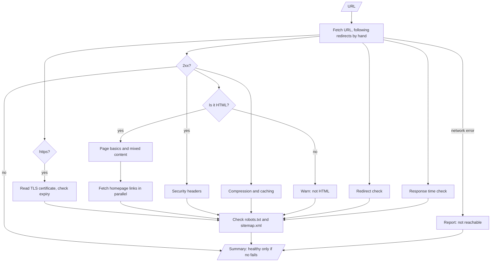

# Architecture

## What "healthy" means

A site is healthy when visitors can reach it, it is secure enough to trust, and
its basic pages and links work. Those three things are failures. Problems
that affect quality but not access (missing headers, weak metadata, no
sitemap) are warnings. This split keeps the verdict meaningful: a fail always
means something is broken.

## Flow

## Components

- **Fetcher** (`fetch`, `follow_redirects`): one request per URL, with a timeout.
  Redirects are followed by hand, so the chain of hops can be reported and loops
  detected.
- **Page reader** (`PageParser`): one pass over the HTML, using the standard
  library's HTML parser.
- **Rules** (`tls_status`, `timing_status`): pure functions with no network
  access, so they are easy to test.
- **Checks** (`check_*`): each returns `{name, status, detail}`.
- **Summary** (`check_site`, `_summary`): runs the checks and decides healthy or not.

## Limits

- Only the homepage's links are checked, not the whole site.
- Only the first 2 MB of each page are read.
- No check of performance beyond one response time, no load testing, no
  accessibility audit beyond page basics.
- Results depend on the network the checker runs from.

## Typical cost

For a site with no redirects, one run makes:

- 1 request for the homepage (plus 1 per redirect),
- 1 TLS handshake to read the certificate,
- 1 request each for robots.txt and sitemap.xml,
- 1 request per homepage link (up to `--max-links`, default 30), run 8 at a time.

Connections are not reused, which keeps the code simple at a small speed cost.
A run against github.com with 30 links took about 2 seconds in testing. There
is no paid service or API call.
